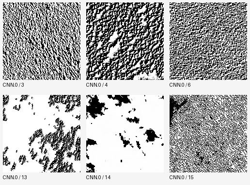
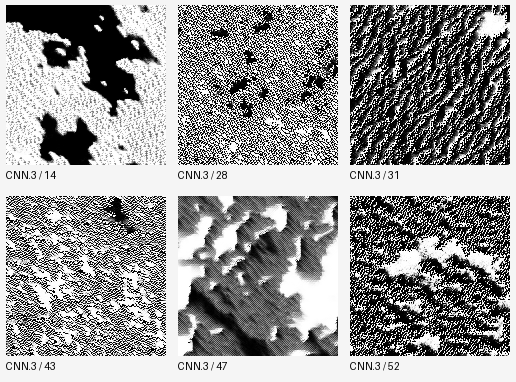
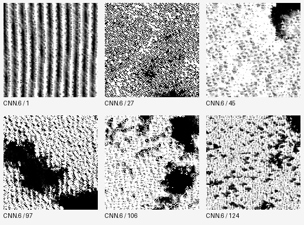

# Crystal 8 — maksymalizacja po ReLU na pełnym obrazie

Każdy PNG ma 500×500 px, tyle co wejście treningowe. Dla każdego kanału optymalizowano osobne widmo całego obrazu. Sieć w każdym kroku otrzymywała wszystkie piksele. Każdy atlas pokazuje centralne wycinki 160×160 px w skali 1:1. Kliknięcie numeru kanału otwiera cały obraz.

Użyto wag z `CNN_checkpoint_8` i architektury z `Crystal.py`. Zachowano 18 kanałów z porównania kafli 40 i 60 px. Cel to średnia po wszystkich pozycjach mapy po ReLU, przed następnym poolingiem. Adam (120 kroków, lr 0,09) zmieniał zespolone współczynniki Fouriera. Wagi widma wynosiły 0,25 / max(f, 1/500), gdzie f to częstotliwość radialna w cyklach/piksel. Po odwrotnej FFT sigmoid ograniczał jasność do zakresu [0,1]. Każdy kanał miał osobny losowy start. Przy wyniku poniżej połowy wcześniejszej aktywacji z kafla 60 px dodano drugi start z fali o zmiennej fazie i szumem, wybranej na podstawie odpowiedzi na sondy kierunkowe. Zachowano silniejszy wynik.

Pola recepcyjne pojedynczych pozycji po kolejnych splotach mają boki 3, 8 i 18 px. Drobna struktura może zatem pojawiać się w wielu miejscach także przy swobodnej optymalizacji całego obrazu. Start i końcowy PNG oceniono na pełnym wejściu. Kolumna 60 px to wcześniejszy pomiar tego samego kanału na powielonym kaflu, przy innym budżecie optymalizacji.

## CNN.0

| Kanał | Start | PNG 500 px | PNG z kafla 60 px |
|---|---:|---:|---:|
| [3](CNN.0_k003.png) | 0.0276 | 0.1670 | 0.2248 |
| [4](CNN.0_k004.png) | 0.0118 | 0.1233 | 0.1700 |
| [6](CNN.0_k006.png) | 0.0577 | 0.1992 | 0.2084 |
| [13](CNN.0_k013.png) | 0.0152 | 0.1279 | 0.2097 |
| [14](CNN.0_k014.png) | 0.1477 | 0.3346 | 0.3452 |
| [15](CNN.0_k015.png) | 0.0051 | 0.1149 | 0.1255 |

## CNN.3

| Kanał | Start | PNG 500 px | PNG z kafla 60 px |
|---|---:|---:|---:|
| [14](CNN.3_k014.png) | 0.2901 | 0.9305 | 0.9895 |
| [28](CNN.3_k028.png) | 0.0174 | 3.1666 | 3.3357 |
| [31](CNN.3_k031.png) | 0.0940 | 0.8862 | 0.9147 |
| [43](CNN.3_k043.png) | 0.0245 | 1.1561 | 1.2590 |
| [47](CNN.3_k047.png) | 0.0293 | 0.3935 | 0.5076 |
| [52](CNN.3_k052.png) | 0.0457 | 1.1508 | 1.3918 |

## CNN.6

| Kanał | Start | PNG 500 px | PNG z kafla 60 px |
|---|---:|---:|---:|
| [1](CNN.6_k001.png) | 0.4467 | 1.0101 | 1.4529 |
| [27](CNN.6_k027.png) | 0.1336 | 21.2256 | 23.1220 |
| [45](CNN.6_k045.png) | 0.2814 | 1.6423 | 1.9322 |
| [97](CNN.6_k097.png) | 0.3357 | 3.4878 | 3.8395 |
| [106](CNN.6_k106.png) | 0.5381 | 2.7614 | 3.3863 |
| [124](CNN.6_k124.png) | 0.8315 | 2.9934 | 3.1744 |
